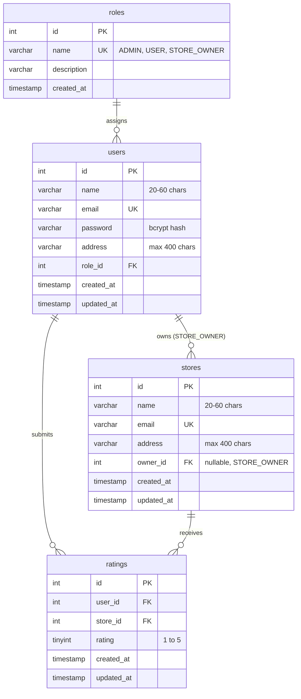

# Roxiler Store Rating Management System

A production-ready full-stack web application that allows users to register, browse stores, submit and modify ratings (1 to 5 stars), with dedicated role-based dashboards for **System Administrators**, **Store Owners**, and **Normal Users**.

Built with **React.js**, **Tailwind CSS**, **Node.js**, **Express.js**, and **MySQL**.

---

## 🌟 Key Features

### 1. Role-Based Access Control (RBAC)
- **System Administrator**:
  - Centralized Dashboard with summary metrics: Total Users, Total Stores, Total Ratings, Overall Average Rating, and Recent Activity.
  - User Management: Search by name, email, or address; filter by role; sort by column; view detailed activity and rating history; create new users.
  - Store Management: Search and filter stores; sort by column; create stores with assigned Store Owners; view customer ratings breakdown.
- **Normal User**:
  - Interactive Store Directory: Search stores by name and address; sort by rating, name, or recency; view both overall average rating and user's own submitted rating.
  - Submit & Modify Ratings: Submit a 1 to 5 star rating; modify existing ratings on the fly (one rating per user per store strictly enforced).
  - Personal Dashboard & My Ratings: Track all submitted reviews, view personal average ratings, and edit reviews.
  - Profile & Password Security: Secure password change.
- **Store Owner**:
  - Dedicated Store Dashboard: View overall average store rating, total customer reviews, and a 5-to-1 star distribution breakdown.
  - Customer Feedback List: Search and filter customer ratings by customer name, email, or star score with sortable columns.
  - Profile & Password Security: Secure password change.

### 2. Security & Input Validation (Section 8 Compliant)
- **Password Security**: Passwords hashed using `bcrypt` (10 rounds). Passwords are never exposed in API responses.
- **JWT Authentication**: Protected REST endpoints using signed JSON Web Tokens attached via `Authorization: Bearer <token>`.
- **Server-Side Authorization Middleware**: Strict route guards (`authorize('ADMIN')`, `authorize('USER')`, `authorize('STORE_OWNER')`).
- **SQL Injection Prevention**: 100% parameterized SQL queries via `mysql2/promise`.
- **Validation Rules**:
  - **Name**: 20–60 characters (strictly validated on backend & frontend).
  - **Address**: Maximum 400 characters.
  - **Password**: 8–16 characters, containing at least one uppercase letter and at least one special character (`(?=.*[A-Z])(?=.*[!@#$%^&*()_+\-=\[\]{};':"\\|,.<>\/?~`])`).
  - **Email**: Valid email format normalized to lowercase.
  - **Rating**: Integer between 1 and 5. Unique constraint `(user_id, store_id)` ensures only one rating per store, which can be modified.

---

## 📐 Technology Stack

| Layer | Technologies |
|---|---|
| **Frontend** | React 18, Vite, Tailwind CSS, Lucide Icons, Axios, React Router DOM |
| **Backend** | Node.js, Express.js, JWT, bcryptjs, express-validator, Helmet, CORS, Morgan |
| **Database** | MySQL 8.0 (InnoDB, Foreign Keys, Unique Constraints, Indices) |
| **Testing** | Jest, Supertest (19 comprehensive automated integration tests) |

---

## 🗄️ Database Architecture

The MySQL database schema is located in `database/schema.sql` and includes 4 normalized tables:



---

## 🚀 Quick Start & Installation

### Prerequisites
- [Node.js](https://nodejs.org/) (v18 or v20+)
- [MySQL Server 8.0](https://dev.mysql.com/downloads/mysql/) running locally on port `3306`

### 1. Database Setup
Ensure MySQL is running. The backend automatically creates the `roxiler_store_rating` database and required tables upon boot, or you can run:
```bash
mysql -u root -p < database/schema.sql
```

### 2. Environment Variables Configuration

#### Backend (`server/.env`):
```env
PORT=5000
NODE_ENV=development

# MySQL Database Configuration
DB_HOST=localhost
DB_PORT=3306
DB_USER=root
DB_PASSWORD=root
DB_NAME=roxiler_store_rating

# JWT Configuration
JWT_SECRET=roxiler_super_secret_jwt_key_2026_secure
JWT_EXPIRES_IN=7d

# CORS
CLIENT_URL=http://localhost:5173
```

#### Frontend (`client/.env`):
```env
VITE_API_URL=http://localhost:5000/api
```

### 3. Install Dependencies & Seed Database

```bash
# Install backend dependencies
cd server
npm install

# Seed default roles, test users, stores, and ratings
npm run seed

# Install frontend dependencies
cd ../client
npm install
```

### 4. Running the Application

In terminal 1 (start backend server):
```bash
cd server
npm run dev
# Server starts at http://localhost:5000
```

In terminal 2 (start React client):
```bash
cd client
npm run dev
# Frontend starts at http://localhost:5173
```

---

## 🔑 Default Seed Accounts

The database comes pre-seeded with accounts ready for immediate testing (you can also use the **Quick Fill** buttons directly on the Login page):

| Role | Email | Password | Name |
|---|---|---|---|
| **System Administrator** | `admin@roxiler.com` | `Admin@123` | System Administrator Root |
| **Store Owner #1** | `owner1@roxiler.com` | `Owner@123` | Robert Michael Smith Owner |
| **Store Owner #2** | `owner2@roxiler.com` | `Owner@123` | Samantha Jane Davies Owner |
| **Normal User #1** | `john.doe@example.com` | `User@1234` | Johnathan Edward Doe Normal |
| **Normal User #2** | `emily.watson@example.com` | `User@1234` | Emily Victoria Watson Normal |

*(All passwords meet the 8-16 char length, 1 uppercase letter, and 1 special character requirement).*

---

## 🧪 Automated Testing

A comprehensive automated integration test suite is located in `server/tests/api.test.js`.

To run the test suite:
```bash
cd server
npm test
```

### Test Coverage Summary:
- ✅ **Health Check**: Server availability check.
- ✅ **Authentication**: Login validation, JWT generation, password verification.
- ✅ **Input Validation**: Strict enforcement of 20-60 char names, password regex complexity (uppercase + special symbol), address length.
- ✅ **Role Authorization**: Verifies Normal Users cannot access Admin/Store Owner endpoints (403 Forbidden).
- ✅ **Admin Operations**: Dashboard stats calculation, user filtering/sorting, store creation.
- ✅ **Store & Ratings**: Public search, rating submission (1-5), rating modification, duplicate rating handling.
- ✅ **Store Owner Operations**: Store owner dashboard metrics, customer rating logs.
- ✅ **Password Updates**: Password change workflow with current password verification.

---

## 📡 API Reference

### Auth Endpoints
- `POST /api/auth/register` - Register a new normal user
- `POST /api/auth/login` - Authenticate user & issue JWT
- `GET /api/auth/profile` - Get logged-in user profile (`Bearer` token required)
- `PUT /api/auth/change-password` - Update current password

### Admin Endpoints (Requires `ADMIN` role)
- `GET /api/admin/dashboard-stats` - Aggregated system stats
- `GET /api/admin/users` - Search, filter, sort, and paginate users
- `POST /api/admin/users` - Create a user with specified role
- `GET /api/admin/users/:id` - Detailed user info and ratings history
- `GET /api/admin/stores` - Search, filter, sort, and paginate stores
- `POST /api/admin/stores` - Create a store and assign owner
- `GET /api/admin/stores/:id` - Store details with all customer ratings
- `GET /api/admin/store-owners` - List of store owners for assignment

### Store Endpoints (Public / Authenticated)
- `GET /api/stores` - Browse stores with search (`name`, `address`), sort (`name`, `rating`, `address`), and pagination. Attaches current user's rating if logged in.
- `GET /api/stores/:id` - Get store details

### Rating Endpoints (Requires `USER` role)
- `POST /api/ratings` - Submit or modify a rating (1 to 5)
- `PUT /api/ratings/:storeId` - Modify an existing rating
- `GET /api/ratings/my-ratings` - Get all ratings submitted by the current user

### Store Owner Endpoints (Requires `STORE_OWNER` role)
- `GET /api/store-owner/dashboard` - Average rating, review counts, 5-to-1 star distribution
- `GET /api/store-owner/ratings` - List of users who rated their store with filter and sort

---

## 🛡️ License

This project was developed for the Roxiler Store Rating Assessment. All rights reserved.
